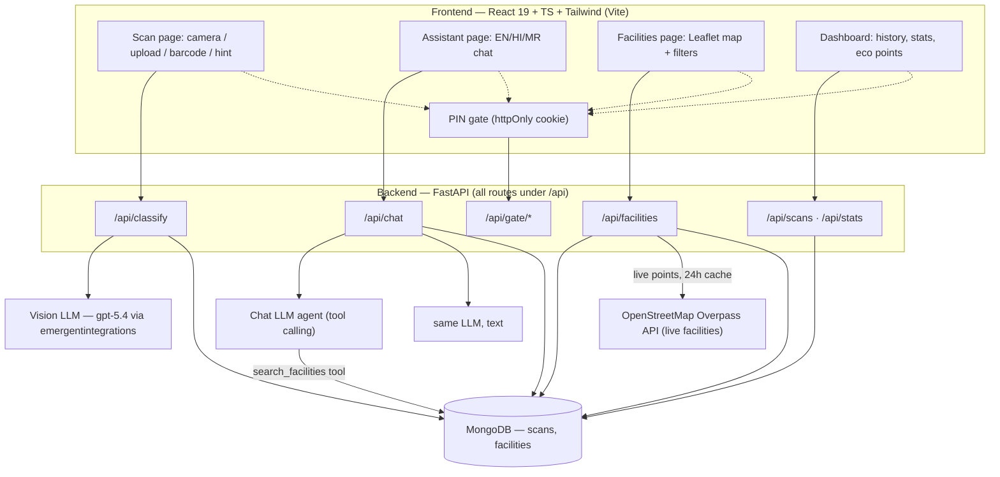

# Step 1 — System architecture & tech stack

## 1.1 Architecture (as built in this repo)

**Why this shape**

- The **vision LLM is the classifier** — zero training infrastructure, explains
  its answer, handles hints/barcodes, and speaks Hindi/Marathi out of the box.
  The CNN path (Step 3 of your report) stays as the offline/mobile upgrade.
- **FastAPI** gives typed request/response models (Pydantic) that the frontend
  mirrors by hand (`src/lib/types.ts`) — one contract, no drift.
- **MongoDB** stores scans + a cached facility index; the curated Chiplun seed
  guarantees the demo always works even with no internet for OSM.
- **Safety by design**: hazardous/biomedical guidance is constrained in both
  the classifier and the agent prompts, with a canned safe fallback if the
  model is unreachable.

## 1.2 Tech stack — Option A (free / student-friendly) vs Option B (production)

| Layer | A — free/student (this repo) | B — production-grade | Why |
|---|---|---|---|
| Classifier | Vision LLM API (gpt-5.4 class) | Fine-tuned MobileNetV3/EfficientNet → TFLite on-device + LLM fallback | A: zero GPU, instant. B: ~₹0 per inference, works offline, milliseconds |
| Detection (multi-item) | Single-item per photo | YOLOv8/v11 for many-items-per-frame | B needed for bin-level / bulk photos |
| LLM chat | Hosted model via one API key | Self-hosted (vLLM) or enterprise API + RAG over rulebooks | A: no infra. B: data control + RAG on SWM/E-Waste rules PDFs |
| Maps | Leaflet + OSM tiles + Overpass (free) | Google Maps/Places API + Directions | A: ₹0, no key. B: better India POI coverage, turn-by-turn |
| Backend | FastAPI + Uvicorn (1 pod) | FastAPI + Gunicorn workers behind nginx, Redis queue for images | B: horizontal scale, rate limiting |
| DB | MongoDB (local/Atlas free tier) | MongoDB Atlas M10+ with backups & PITR | B: durability |
| Auth | 4-digit demo PIN (httpOnly cookie) | Email/Google auth (e.g. managed Clerk), roles for NGO staff | B: multi-user, audit |
| Images | Base64 in request (≤1 MB) | Object storage (S3/R2) + presigned uploads | B: keeps payloads small, enables retraining data |
| Hosting | Free tiers: Render/Railway/Fly (backend) + Vercel/Netlify (frontend) | Docker on a VPS or cloud run with CI/CD | A: ₹0/month student budget |

**Cost of Option A**: effectively only LLM tokens for scans/chat; maps, tiles,
POI data and hosting are free tiers.

## 1.3 Component decisions you may be asked about in the viva

- *Why not train a CNN now?* You need ~5k+ labelled local images and a GPU;
  the vision-LLM route lets the product exist today, and every scan you collect
  becomes training data for the CNN later (that's the dataset plan in Step 2).
- *Why is confidence + follow-up important?* Waste bins are high-stakes: a
  wrong "recyclable" contaminates a batch. The app refuses to guess below 65%
  and asks one clarifying question instead.
- *Why cache Overpass?* Politeness rules forbid hammering OSM; 24h caching plus
  a curated seed keeps the map instant and always available offline of OSM.
